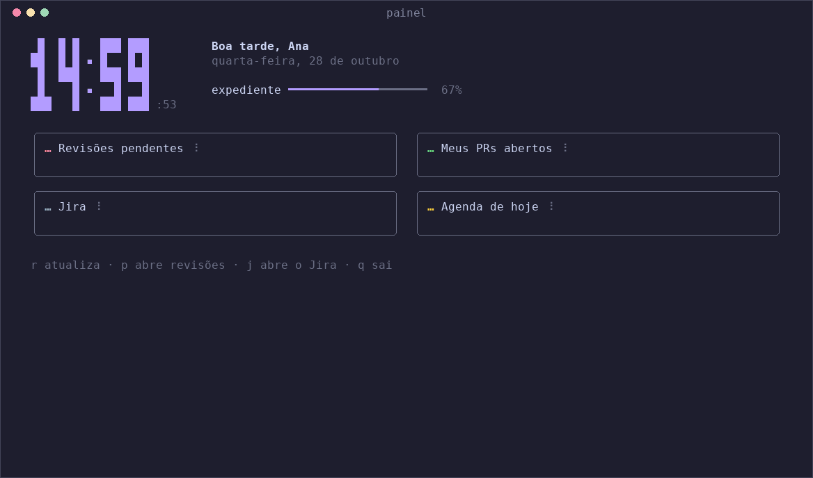

# painel

Um dashboard pessoal para o terminal. Você digita `painel` e aparece uma tela
que fica se atualizando sozinha com o que importa no seu dia de trabalho: PRs
esperando a sua revisão, os seus PRs abertos, a agenda de hoje e a hora.



As cores se adaptam a temas claros e escuros do terminal. Os dados acima são
fictícios.

## O que aparece na tela

| Bloco | O que mostra |
|---|---|
| **Relógio** | Hora em dígitos grandes, segundos, saudação ("Bom dia", "Boa tarde", "Boa noite") e a data por extenso em português |
| **Expediente** | Barra com quanto do dia útil (9h–18h) já passou. No fim de semana, avisa que é fim de semana |
| **Agora / próxima** | A reunião em andamento ou a próxima, com quanto tempo falta ("próxima: Daily em 12 min") |
| **Revisões pendentes** | PRs abertos em que pediram revisão **diretamente a você**, com há quanto tempo cada um espera (o mais antigo no topo, em amarelo a partir de 1 dia e vermelho a partir de 3), e abaixo quantos pedidos foram feitos só aos seus times |
| **Meus PRs abertos** | PRs abertos de sua autoria com o estado do CI (✓ ✗ ●), marcadores de **aprovado**, **mudanças** pedidas e **conflito**, e um resumo do que pede atenção. Rascunhos (draft) aparecem apagados |
| **Agenda de hoje** | Eventos do dia. Os que já passaram ficam riscados, o atual fica destacado e os de dia inteiro vêm primeiro |
| **Jira** (opcional) | Cards atribuídos a você e não concluídos, os em andamento primeiro e com o status ("Em revisão"…), mais o resumo "N em andamento · N a fazer" |

Os números se atualizam sozinhos: PRs a cada 2 minutos e agenda a cada 5. O
relógio vira a cada segundo. As caixas se organizam conforme a largura do
terminal: lado a lado, em grade (2×2 com o Jira) ou empilhadas.

Detalhes de como cada número é calculado estão em
[docs/funcionamento.md](docs/funcionamento.md).

## Começo rápido

A única dependência é o **GitHub CLI (`gh`)** autenticado
([instalação](https://cli.github.com/)). Confira com `gh auth status`. Se não
estiver logado, rode `gh auth login`.

### Baixar pronto (recomendado)

Não precisa de Go. Escolha o arquivo do seu sistema:

| Sistema | Arquivo |
|---|---|
| Linux (Intel/AMD) | `painel_linux_amd64.tar.gz` |
| Linux (ARM) | `painel_linux_arm64.tar.gz` |
| macOS com Apple Silicon (M1 em diante) | `painel_darwin_arm64.tar.gz` |
| macOS com Intel | `painel_darwin_amd64.tar.gz` |
| Windows | `painel_windows_amd64.zip` |

No Linux e no macOS (troque o nome do arquivo pelo seu):

```sh
gh release download --repo mvabf/painel --pattern 'painel_linux_amd64.tar.gz' --dir /tmp/painel --clobber
mkdir -p ~/.local/bin
tar xzf /tmp/painel/painel_linux_amd64.tar.gz -C ~/.local/bin painel
painel version
```

No Windows, baixe o `.zip` da [última versão](https://github.com/mvabf/painel/releases/latest),
extraia o `painel.exe` para uma pasta que esteja no `PATH` e rode pelo Windows
Terminal.

Para **atualizar**, repita os mesmos comandos: eles sempre pegam a versão mais
recente.

### Compilar do código

Precisa do **Go 1.24 ou mais novo** ([instalação](https://go.dev/doc/install)):

```sh
git clone git@github.com:mvabf/painel.git
cd painel
make install        # instala em ~/.local/bin/painel
```

### `PATH`

Se aparecer `painel: command not found`, adicione `~/.local/bin` ao `PATH` no
seu `~/.zshrc` ou `~/.bashrc` e abra um terminal novo:

```sh
export PATH="$HOME/.local/bin:$PATH"
```

Com isso, os PRs já aparecem. A agenda pede um passo a mais, explicado na
próxima seção.

## Conectando a agenda

O painel lê a agenda de três jeitos. Escolha o primeiro que funcionar pra você:

1. **Endereço secreto iCal do Google Calendar**: o mais simples. É só colar um
   link no arquivo de configuração.
2. **Login no Google Calendar (`painel auth`)**: para contas Google Workspace
   em que o administrador desativou o endereço secreto.
3. **Arquivo `.ics` local**: qualquer calendário exportado (Outlook, Apple,
   Google…). Não se atualiza sozinho, então serve mais para testar.

O passo a passo de cada um, com os erros comuns, está em
[docs/agenda.md](docs/agenda.md).

## Conectando o Jira

Opcional. Funciona com o Jira Cloud e um
[token de API da Atlassian](https://id.atlassian.com/manage-profile/security/api-tokens).
Adicione ao `~/.config/painel/config`:

```sh
JIRA_URL=https://suaempresa.atlassian.net
JIRA_EMAIL=voce@empresa.com
JIRA_TOKEN=seu-token
```

Se você já tem um arquivo com `JIRA_BASE_URL`, `JIRA_EMAIL` e `JIRA_API_TOKEN`
(os nomes que outras ferramentas usam), aponte para ele em vez de copiar o token:

```sh
ENV_FILE=~/caminho/para/segredos.env
```

Por padrão, a caixa mostra `assignee = currentUser() AND statusCategory != Done`.
Para outra busca, use `JIRA_JQL`. Detalhes em
[docs/configuracao.md](docs/configuracao.md#jira).

## Notificações

O painel pode avisar no desktop (com som, se você quiser) quando chega um
pedido de revisão, quando um PR seu é aprovado ou o CI falha, quando aparece
um card novo no Jira e 5 minutos antes de cada reunião. Vem desligado; para
ligar:

```sh
NOTIFY=on
NOTIFY_SOUND=ci,meeting   # som só para o que é urgente
```

Detalhes e o que funciona em cada sistema em
[docs/notificacoes.md](docs/notificacoes.md).

## Atalhos

| Tecla | Ação |
|---|---|
| `r` | Atualiza tudo agora |
| `p` | Abre no navegador a lista de PRs pedindo sua revisão |
| `j` | Abre no navegador a busca do Jira (se configurado) |
| `q`, `esc` ou `ctrl+c` | Sai |

## Comandos

```sh
painel          # abre o dashboard
painel auth     # login no Google Calendar (uma vez)
painel version  # versão instalada
painel help     # ajuda
```

## Configuração

Tudo é opcional. O painel lê `~/.config/painel/config`, um arquivo no formato
`CHAVE=valor`:

```sh
NAME=Ana
ICS_URL=https://calendar.google.com/calendar/ical/.../private-.../basic.ics
EMAIL=ana@empresa.com
PR_INTERVAL=2m
CAL_INTERVAL=5m
REVIEW_MAX_AGE=7d    # só pedidos de revisão da última semana
NOTIFY=on            # avisos no desktop
JIRA_URL=https://empresa.atlassian.net
```

Não precisa recompilar nada: o painel lê o arquivo toda vez que abre.

Qualquer chave também pode vir de uma variável de ambiente com o prefixo
`PAINEL_`, que tem prioridade sobre o arquivo (ex.: `PAINEL_NAME=Ana painel`).

A referência completa de cada chave, com os valores padrão, está em
[docs/configuracao.md](docs/configuracao.md).

## Privacidade

- O painel **só lê**. Não cria, edita nem comenta nada no GitHub ou na agenda.
- Nada sai da sua máquina além das consultas ao GitHub e ao Google. Não há
  servidor próprio nem telemetria.
- As credenciais ficam em `~/.config/painel/`, fora do repositório e com
  permissão só para o seu usuário.

O que é guardado, onde, e com quais permissões está em
[docs/seguranca.md](docs/seguranca.md).

## Problemas comuns

| Sintoma | Causa provável |
|---|---|
| `gh: ... not logged in` na caixa de PRs | Rode `gh auth login` |
| `painel: command not found` | `~/.local/bin` fora do `PATH` (veja [Começo rápido](#começo-rápido)) |
| Agenda com `HTTP 404` | Você usou o endereço **público** em vez do **secreto** |
| `não achei .../google-client.json` | Falta o passo do Google Cloud em [docs/agenda.md](docs/agenda.md#2-login-no-google-calendar-painel-auth) |
| Números param de mudar e aparece um erro em vermelho | Falha de rede ou da API. O painel mantém os últimos números e tenta de novo no próximo ciclo |

A lista completa está em [docs/problemas.md](docs/problemas.md).

## Documentação

| Documento | Para quem |
|---|---|
| [docs/agenda.md](docs/agenda.md) | Conectar a agenda (iCal, Google, arquivo) |
| [docs/configuracao.md](docs/configuracao.md) | Referência de todas as opções |
| [docs/funcionamento.md](docs/funcionamento.md) | Como os números são calculados e quando atualizam |
| [docs/notificacoes.md](docs/notificacoes.md) | Avisos no desktop e com som |
| [docs/seguranca.md](docs/seguranca.md) | O que é guardado e quais acessos o painel tem |
| [docs/problemas.md](docs/problemas.md) | Erros e como resolver |
| [docs/arquitetura.md](docs/arquitetura.md) | Como o código é organizado, para quem quer contribuir |
| [docs/release.md](docs/release.md) | Como publicar uma versão nova |

## Contribuindo

Ideias e PRs são bem-vindos. Para rodar a partir do código:

```sh
make build && ./painel   # compila e roda
make test                # testes
```

O CI roda formatação, `go vet`, testes e a compilação para todos os sistemas
em cada push e PR.

Antes de mexer, leia [docs/arquitetura.md](docs/arquitetura.md). Ele explica o
modelo do Bubble Tea, onde fica cada coisa e como adicionar uma caixa nova.

## Feito com

- [Bubble Tea](https://github.com/charmbracelet/bubbletea) e
  [Lip Gloss](https://github.com/charmbracelet/lipgloss) para a interface
- [gocal](https://github.com/apognu/gocal) para ler calendários iCal
- [GitHub CLI](https://cli.github.com/) para buscar os PRs

## Licença

[MIT](LICENSE): use, modifique e distribua à vontade, mantendo o aviso de
copyright.
